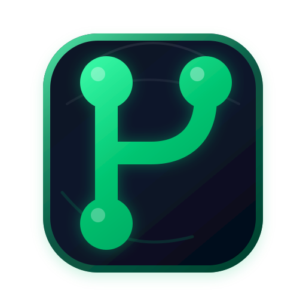
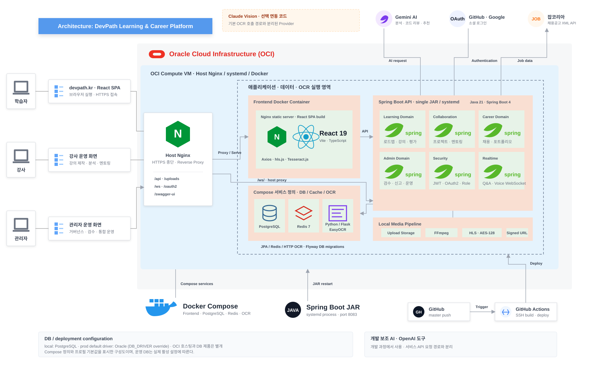

<div align="center">
  

  <h1>DevPath</h1>
  <p><strong>개발자의 학습, 프로젝트, 커리어 성장을 하나로 잇는 성장 플랫폼</strong></p>

  <p>
    <a href="https://devpath.kr"><strong>서비스 바로가기</strong></a>
    ·
    <a href="#서비스-한눈에-보기">서비스 소개</a>
    ·
    <a href="#자세히-보기">자세히 보기</a>
    ·
    <a href="#팀원">팀원</a>
  </p>

  <p>
    
    
    
    
    
    
    
  </p>
</div>

---

## 서비스 한눈에 보기

DevPath는 개발자의 성장 과정을 학습, 실습, 협업, 커리어까지 연결하는 웹 플랫폼입니다.
학습자는 맞춤 로드맵과 강의로 방향을 잡고, 팀 워크스페이스와 멘토링으로 프로젝트 경험을 쌓으며, 커리어 기능으로 결과물을 정리할 수 있습니다.

| 구분 | 내용 |
| --- | --- |
| 서비스 URL | [https://devpath.kr](https://devpath.kr) |
| 주요 사용자 | 학습자, 강사, 관리자 |
| 핵심 흐름 | 로드맵 추천 → 강의 학습 → 프로젝트 협업 → 포트폴리오와 채용 분석 |
| 레포 구성 | Spring Boot 백엔드, Vite React 프론트엔드, Python OCR 서버, Docker Compose 인프라 |

## 주요 카테고리

| 아이콘 | 카테고리 | 핵심 기능 |
| --- | --- | --- |
| 🧭 | 학습 로드맵 | 맞춤 로드맵, 강의 탐색, 학습 플레이어, 퀴즈와 과제 |
| 🧑‍🏫 | 강사 운영 | 강의 관리, 콘텐츠 편집, 수강생 분석, Q&A, 수익 관리 |
| 🧩 | 팀 프로젝트 | AI 주제 추천과 프로젝트 설계서, 워크스페이스, 칸반, 일정, 파일, 화상 회의, ERD, API 명세서, 면접 준비 |
| 💼 | 커리어 | 채용 분석, 이력서, 포트폴리오, Proof Card, 쇼케이스 |
| 💬 | 커뮤니티 | 라운지, 게시글, 댓글, 좋아요, 멘토링 허브 |
| 🛡️ | 관리자 | 계정 관리, 로드맵 거버넌스, 강의 검수, 신고 처리 |
| 🤖 | AI/OCR | Gemini 프로젝트 설계·면접 질문 생성, 워크스페이스 AI 에이전트, AI 코드·디자인 리뷰, 영상 학습 OCR |

## 자세히 보기

<details>
<summary><strong>🧭 서비스 핵심 기능 자세히 보기</strong></summary>

### 학습자

- 맞춤 로드맵과 로드맵 허브를 통해 학습 방향을 탐색합니다.
- 강의 목록과 학습 플레이어로 콘텐츠를 수강합니다.
- 퀴즈, 과제, 학습 로그를 통해 학습 결과를 관리합니다.

### 강사

- 강의와 콘텐츠를 등록하고 관리합니다.
- 과제와 퀴즈를 편집하고 수강생 학습 데이터를 확인합니다.
- 멘토링, Q&A, 리뷰, 수익 관리 화면을 제공합니다.

### 프로젝트와 협업

- 팀 워크스페이스에서 칸반, 일정, 파일, 회의, ERD를 관리합니다.
- 스쿼드 워크스페이스와 멘토링 워크스페이스를 제공합니다.
- 코드 리뷰와 실시간 협업 흐름을 지원합니다.

### AI 스쿼드 워크스페이스

1. `/workspace-hub`의 **새 프로젝트 시작**에서 **AI에게 주제 추천받기** 또는 **내가 직접 설정하기**를 선택합니다.
2. AI 추천에서는 토이 프로젝트·실전 MVP·엔터프라이즈 난이도와 기술 스택 자동 추천·직접 설정을 선택합니다. 서비스 아이디어를 입력하면 이를 구체화하고, 입력하지 않으면 난이도에 맞는 주제를 추천합니다.
3. Gemini가 **기획 & 시나리오**, **아키텍처 & DB**, **API 명세서**, **개발 로드맵 & 면접**을 생성합니다. 모달을 닫거나 백그라운드 실행을 선택하면 다른 페이지에서도 작업 상태와 완료 알림을 확인할 수 있습니다.
4. 결과를 확인하고 워크스페이스를 만들면 설계 내용이 작업 카드, ERD, API 명세서, Phase 일정, 면접 질문과 자료실 문서로 연결됩니다. 팀원은 초대를 통해 참여합니다.

| 메뉴 | 역할 |
| --- | --- |
| 대시보드 | 기능별 연결 작업 진행률, 내 작업, 현재 날짜에 해당하는 개발 로드맵 Phase와 팀 활동 |
| 프로젝트 설계서 | 기획·시나리오, 아키텍처, API와 로드맵·면접 내용 확인 및 설계 편집 |
| 작업 현황판 | 작업 생성·배정·상태 변경, MVP 기능과 API 엔드포인트 연결 |
| ERD 설계 / API 명세서 | 추천 모델 편집, API 그룹·엔드포인트·응답 예시 관리, 연결 작업과 구현 상태 확인 |
| 일정 관리 / 팀 자료실 | Phase 마일스톤과 작업 마감일, 자동 생성 설계 문서와 팀 파일 관리 |
| 면접 준비 | 질문·모범 답안, 개인 답변과 팀원 답변, 질문 추가, 모의 면접과 연습 리포트 |
| 화상 회의 | 실제 참가자 기준 회의 화면, 카메라·마이크·화면 공유 |
| 스쿼드 설정 / 코드 피드백 | 팀원 초대·담당 직군·외부 연동 설정, GitHub 연동 후 코드 피드백 이용 |

설계 생성 작업은 DB에 저장하고 Redis를 조회 캐시로 사용합니다. 미완료 작업은 서버 시작과 주기적인 복구 처리에서 다시 실행하며, Redis 장애 시 DB 조회를 사용할 수 있습니다. 브라우저에는 작업 ID를 보관하므로 같은 브라우저에서 다시 접속해 진행 상태를 확인할 수 있습니다.

페이지를 이동할 때는 목적지에 필요한 데이터만 사전 조회하고 방문한 화면의 입력 상태를 보존합니다. 면접 질문과 모범 답안은 개인 기록·근거 자료 조회와 분리해 먼저 표시하며, 개인 기록을 읽기 전에는 편집과 저장을 잠가 기존 답변을 보호합니다.

### 커리어와 커뮤니티

- 채용 분석, 이력서, 포트폴리오, Proof Card 기능을 제공합니다.
- 커뮤니티 라운지, 게시글, 댓글, 좋아요, 쇼케이스를 제공합니다.

### 관리자

- 관리자 대시보드에서 계정, 기술 태그, 공식 로드맵, 노드 추천 자료, 강의 메뉴, 강의 검수와 신고를 운영합니다.
- 통합 운영 센터에서 채용·기업, 학습 자동화, 추천·분석, A/B 실험, 플랫폼 공지, 환불·정산과 외부 의존성 상태를 운영하며 일반 사용자는 공개된 플랫폼 공지를 조회할 수 있습니다.
- 제한 관리자 Role은 대시보드, 계정, 거버넌스, 검수, 채용, 학습, 공지, 정산 권한을 조합해 배정하며 각 권한은 실제 관리자 API 인가에 적용됩니다.
- 강의 HLS URL은 수강생, 공개 강의의 미리보기 차시, 강사 소유자와 거버넌스 권한 관리자에게만 발급하고 시스템 정책의 최대 동시 학습 기기 수를 브라우저 기기 식별자 기준으로 적용합니다.
- A/B 실험은 생성, 시작, 일시 중지, 재개, 결과 저장과 완료 상태를 관리합니다. 외부 이벤트 수집 인프라는 포함하지 않으므로 검증된 지표 JSON을 관리자가 저장합니다.

</details>

<details>
<summary><strong>🏗️ 아키텍처 자세히 보기</strong></summary>

<p align="center">
  
</p>

| 구성 | 역할 |
| --- | --- |
| React SPA | 학습자·강사·관리자 화면, 라우팅, Axios API 호출, hls.js 보호 재생, Tesseract.js OCR 폴백 |
| Nginx | Vite 정적 빌드 제공과 `/api`, `/uploads`, `/ws`, OAuth 요청의 Spring Boot 프록시 |
| Spring Boot API | JWT·OAuth2 인증, 도메인 API, AI 설계 작업·복구, 관리자 기능, Q&A·회의 시그널링 WebSocket |
| PostgreSQL / Oracle | 로컬 PostgreSQL과 운영 프로필 기반 관계형 데이터 저장 |
| Redis | 캐시와 실시간 상태 데이터 처리, DB에 저장한 AI 설계 작업의 조회 캐시 |
| Flyway | PostgreSQL·Oracle별 DB 변경 이력, 기존 스키마 도입과 후속 마이그레이션 검증 |
| Local Upload Storage | 업로드 파일과 FFmpeg 변환 HLS·AES 자산 저장 |
| Python OCR Server | Flask, EasyOCR와 OpenCV 기반 학습 영상·이미지 OCR 처리 |
| External Integrations | Gemini·Claude Vision, GitHub·Google OAuth, 잡코리아, GitHub Pull Request, DEV.to 연동 |
| Deployment | GitHub Actions로 Oracle Cloud 서버에 배포하며 Spring Boot는 systemd, 프론트엔드·PostgreSQL·Redis·OCR은 Docker Compose로 실행 |

</details>

### 저장소와 백엔드 패키지 원칙

DevPath는 Spring Boot API, React SPA, OCR 서버와 배포 구성을 한 저장소에서 함께 관리하는 모노레포입니다. 하나의 제품을 구성하는 변경을 같은 PR에서 검증하고 배포 경로별 변경 감지를 적용하기 위한 선택이며, 백엔드 코드는 기능별 패키지와 계층 규칙을 함께 사용합니다.

```text
com.devpath
├─ api.<feature>
│  ├─ controller       # HTTP 요청·응답과 입력 검증
│  ├─ service          # 유스케이스와 트랜잭션 경계
│  └─ dto              # API 요청·응답 모델
├─ domain.<feature>
│  ├─ entity           # 도메인 상태와 상태 변경
│  └─ repository       # 영속성 접근
├─ common
│  ├─ config           # 공통 프레임워크·외부 연동 설정
│  ├─ security         # 인증·인가
│  ├─ exception        # 공통 예외 처리
│  └─ response         # 공통 API 응답
└─ bootstrap.seed      # local 프로필의 시연 데이터 준비
```

기본 의존 방향은 `Controller → Service → Repository → Entity`입니다. Controller는 Repository를 직접 호출하지 않고, `domain`은 `api` DTO나 Controller를 참조하지 않습니다. `common.config`는 애플리케이션 공통 설정, `bootstrap.seed`는 로컬 시작 데이터 준비만 담당합니다. 이 규칙은 아키텍처 테스트로 함께 검증합니다.

<details>
<summary><strong>🛠️ 기술 스택 자세히 보기</strong></summary>

| 구분 | 기술 |
| --- | --- |
| Backend | Java 21, Spring Boot 4, Spring Web MVC, Spring Security, OAuth2 Client, JWT, JPA, Flyway |
| Frontend | React 19, TypeScript 6.0, Vite 8, Tailwind CSS 4, Axios, Chart.js |
| Database | PostgreSQL 15 로컬 환경, Oracle 운영 프로필, Redis 7 |
| AI/OCR | Gemini API 연동, Flask, EasyOCR, OpenCV, Tesseract.js |
| Docs | Springdoc OpenAPI, Swagger UI |
| Infra | Docker, Docker Compose, Nginx |
| Quality | JUnit Platform, H2 테스트 런타임, Spotless, ESLint, Vitest, React Testing Library, Playwright |

</details>

<details>
<summary><strong>🚀 로컬 실행 자세히 보기</strong></summary>

### 사전 준비

- JDK 21
- Node.js 22.12 이상. Docker 개발 환경은 Node.js 24를 사용합니다.
- FFmpeg. 강의 영상 업로드 시 HLS 변환과 AES-128 암호화에 사용하며, 없어도 원본 영상 폴백으로 업로드는 계속됩니다.
- Docker Desktop 또는 Docker Compose
- PostgreSQL과 Redis를 직접 띄우거나 Docker Compose 사용

### 환경 변수

프로젝트 루트에 `.env`를 준비합니다. Spring Boot와 Docker Compose가 이 설정을 읽으며, 실제 값은 공개 저장소에 올리면 안 됩니다.
README에는 필요한 키를 알려주는 예시만 둡니다.
팀에서 공유하는 실제 값은 비공개 채널, 시크릿 관리 도구, 배포 환경 변수로 관리합니다.

```properties
SERVER_PORT=8083

DB_HOST=localhost
DB_PORT=5432
DB_NAME=<database-name>
DB_USER=<database-user>
DB_PASSWORD=<database-password>

REDIS_HOST=localhost
REDIS_PORT=6379
REDIS_PASSWORD=<redis-password>

JWT_SECRET=<base64-hmac-secret>

GITHUB_CLIENT_ID=<github-oauth-client-id>
GITHUB_CLIENT_SECRET=<github-oauth-client-secret>
GOOGLE_CLIENT_ID=<google-oauth-client-id>
GOOGLE_CLIENT_SECRET=<google-oauth-client-secret>

DEVPATH_OAUTH2_REDIRECT_URL=http://localhost:8084/oauth2/redirect
DEVPATH_OAUTH2_ALLOWED_ORIGINS=http://localhost:8084
DEVPATH_CORS_ALLOWED_ORIGINS=http://localhost:8084
DEVPATH_REQUIRE_HTTPS=false

OCR_SERVER_URL=http://localhost:5000
GEMINI_API_KEY=<gemini-api-key>

# PATH에서 ffmpeg를 찾을 수 없을 때 실행 파일의 절대 경로를 지정합니다.
FFMPEG_PATH=<ffmpeg-executable-path>
MEDIA_TRANSCODING_TIMEOUT=10m

# HLS 재생 목록·세그먼트·AES 키 만료 URL 서명. 운영에서는 JWT 키와 분리한 임의 값을 사용합니다.
HLS_URL_SIGNING_SECRET=<hls-url-signing-secret>
HLS_URL_TTL=10m

# 잡코리아 설정이 없으면 수집 API는 성공으로 위장하지 않고 명시적으로 실패합니다.
JOBKOREA_JOB_LIST_URL=<jobkorea-job-list-xml-url>
JOBKOREA_STARTER_LIST_URL=<jobkorea-starter-list-xml-url>
JOBKOREA_API_KEY=<jobkorea-api-key>
```

위 예시는 기본 로컬 프로필의 PostgreSQL 설정입니다. 운영 프로필은 `DB_URL`을 사용하고 `DB_DRIVER`를 지정하지 않으면 Oracle JDBC 드라이버를 기본값으로 사용합니다.

AI 프로젝트 설계에는 유효한 `GEMINI_API_KEY`와 사용 가능한 모델의 할당량이 필요합니다. 사용할 모델과 대체 모델 목록은 `GEMINI_MODEL`, `GEMINI_FALLBACK_MODELS`로 설정할 수 있습니다. HTTP 429 사용량 제한이나 생성 실패는 오류로 안내하며 고정 목업 설계로 성공을 대신하지 않습니다.

### 인프라 실행

```bash
docker compose up -d postgres redis ocr-server
```

### 백엔드 실행

```bash
./gradlew bootRun
```

Windows PowerShell에서는 아래 명령을 사용할 수 있습니다.

```powershell
.\gradlew.bat bootRun
```

### 로컬 데이터 초기화

기본 `local` 프로필에서는 PostgreSQL 스키마와 졸업작품 데모 데이터를 다음 순서로 준비합니다.

1. Spring SQL 초기화가 `db/local/project-schema-prep.sql`을 실행해 Hibernate 시작 전에 프로젝트 관련 보조 스키마와 조건부 데이터를 준비합니다.
2. 애플리케이션 시작 후 Java 초기화기가 사용자, 강의, 로드맵 등의 기준 데이터를 확인합니다. 기준 데이터가 없으면 `db/legacy/seed-data.sql`을 복원하고, 빈 DB에서도 완성된 데모 상태가 되도록 프로젝트 시드를 다시 적용합니다.
3. 나머지 초기화기가 테스트 계정과 권한, 비밀번호, 프론트엔드 초안 강의, 라운지, 멘토링 허브, 프로젝트 경험, 워크스페이스 허브와 스쿼드 데이터를 기능별 `db/local` SQL로 보정합니다.
4. `db/local/learner-workspace`의 SQL은 학습자 워크스페이스, 멘토링, ERD, 코드 리뷰 데모 데이터를 정규화합니다.

정적인 시드 행과 조회문은 SQL 리소스에 두고, Java 초기화기는 실행 순서와 조건 검사, 트랜잭션, BCrypt 비밀번호 생성, 엔티티 기반 복원을 담당합니다. `LocalSeedSqlExecutor`는 이 SQL들을 UTF-8로 읽어 실행합니다.

기능별 Java 초기화기는 `local`, `dev` 프로필에서만 동작합니다. Hibernate 시작 전 `project-schema-prep.sql` 실행은 기본 `local` 설정에 포함됩니다. 각 SQL 묶음은 실행 시점과 복원 조건이 다르고 서버 재시작 시 필요한 데이터를 안전하게 보정하도록 작성되어 있으므로 임의로 합치거나 삭제하지 않습니다.

### DB 마이그레이션

Flyway는 기본 활성화이며 기존 스키마의 변경 이력 관리부터 도입한 상태입니다. 기존 `db/legacy`, `db/local` SQL과 Java 초기화기, 로컬 Hibernate `update` 설정은 유지합니다. 로컬의 `baseline-on-migrate` 기본값은 `true`이므로 비어 있지 않은 기존 DB를 버전 1로 등록합니다. 빈 DB에는 V1 도입 표시 SQL이 적용되며 테이블 생성은 기존 SQL·Hibernate 초기화 흐름이 담당합니다.

운영에서는 자동 baseline을 기본으로 사용하지 않습니다. 스키마와 데이터가 준비된 운영 DB를 확인한 뒤, 처음 도입하는 실행에만 다음 환경 변수를 설정합니다.

```properties
SPRING_FLYWAY_BASELINE_ON_MIGRATE=true
```

이 실행은 기존 스키마를 버전 1로 등록하고 `flyway_schema_history`에 이후 변경 이력을 저장합니다. Flyway는 기존 SQL을 마이그레이션으로 재실행하거나 데이터를 초기화하지 않습니다. 기존 SQL·Java 초기화기는 원래 조건과 순서대로 계속 동작합니다. 운영의 최초 등록이 끝나면 `SPRING_FLYWAY_BASELINE_ON_MIGRATE`를 제거하거나 `false`로 바꿉니다. 로컬에서도 등록 후 `false`로 고정할 수 있습니다.

마이그레이션은 JDBC 연결의 DB 종류에 따라 다음 경로에서 읽습니다.

- PostgreSQL. `src/main/resources/db/migration/postgresql`
- Oracle. `src/main/resources/db/migration/oracle`

각 경로의 `V1__adopt_existing_schema.sql`은 도입 시점 표시이며 전체 초기 스키마를 생성하지 않습니다. 앞으로의 변경은 `V2__변경설명.sql`, `V3__변경설명.sql`처럼 새 버전으로 추가합니다. 두 DB에서 지원할 변경은 각각의 SQL 문법으로 작성하고 검증합니다. 적용한 파일은 수정하거나 이름을 바꾸지 않습니다. 기존 시드 SQL은 전용 경로에 복사하지 않고 현재 초기화기가 계속 실행합니다.

Flyway는 Hibernate보다 먼저 실행합니다. 아직 전체 초기 DDL을 migration으로 옮긴 상태가 아니므로, 기존 테이블을 수정하는 후속 migration을 추가할 때는 빈 DB 초기화도 함께 검증해야 합니다. `clean`은 비활성화하며, 앞으로 작성하는 마이그레이션의 데이터 삭제·컬럼 삭제 여부는 별도로 검토해야 합니다. 전체 초기 DDL 작성과 Hibernate `validate` 전환은 별도 전환 작업입니다. 기존 H2 테스트 프로필에서는 Flyway를 비활성화합니다.

### 프론트엔드 실행

```bash
cd frontend
npm ci
npm run dev
```

### Docker Compose 개발 환경 실행

```bash
docker compose up -d --build
```

이 명령은 Vite 개발 서버, PostgreSQL, Redis와 OCR 서버를 실행합니다. Spring Boot 백엔드는 위의 백엔드 실행 명령으로 별도 실행합니다.

정적 Nginx 프론트엔드 이미지를 확인하려면 `frontend-static` 프로필을 사용합니다.

```bash
docker compose stop frontend-dev
docker compose --profile frontend-static up -d --build frontend
```

`frontend-dev`와 정적 `frontend`는 모두 호스트의 8084 포트를 사용하므로 동시에 실행하지 않습니다.

</details>

<details>
<summary><strong>🔗 로컬 URL과 주요 화면 자세히 보기</strong></summary>

### Local URLs

| 서비스 | 주소 |
| --- | --- |
| Frontend | http://localhost:8084 |
| Backend API | http://localhost:8083 |
| Swagger UI | http://localhost:8083/swagger-ui/index.html |
| OCR Server | http://localhost:5000/health |

### Main Pages

| 경로 | 화면 |
| --- | --- |
| `/` 또는 `/home` | 서비스 홈 |
| `/roadmap-hub` | 로드맵 허브 |
| `/lecture-list` | 강의 목록 |
| `/learning` | 학습 플레이어 |
| `/workspace-hub` | 워크스페이스 허브 |
| `/squad-dashboard` | 스쿼드 대시보드 |
| `/squad-blueprint` | 프로젝트 설계서 |
| `/squad-workspace` | 스쿼드 작업 현황판 |
| `/squad-erd` / `/squad-api` | ERD 설계 / API 명세서 |
| `/squad-review` | GitHub 코드 피드백 |
| `/squad-schedule` / `/squad-files` | 일정 관리 / 팀 자료실 |
| `/squad-meeting` / `/squad-interview` | 화상 회의 / 면접 준비 |
| `/squad-settings` | 스쿼드 설정 |
| `/team-ws-dashboard` | 팀 워크스페이스 |
| `/mentoring-hub` | 멘토링 허브 |
| `/job-matching` | 채용 분석 |
| `/community-list` | 커뮤니티 |
| `/admin-dashboard` | 관리자 대시보드 |

저장된 스쿼드는 `?workspaceId=<워크스페이스 ID>`로 구분합니다. AI 추천으로 만든 스쿼드에는 `&ai=1`이 함께 붙으며, 허브 카드와 ASIDE 메뉴가 해당 워크스페이스 경로를 유지합니다.

### API Docs

백엔드 실행 후 Swagger UI에서 API를 확인할 수 있습니다.

```text
http://localhost:8083/swagger-ui/index.html
```

Vite 개발 서버에서는 프록시가 설정되어 있어 `/api`, `/ws`, `/swagger-ui`, `/v3/api-docs`, `/uploads` 요청이 백엔드로 전달됩니다.

강사가 `lesson-video` 유형으로 영상을 올리고 HLS 정책이 활성화되어 있으면 백엔드는 원본 파일을 보존한 채 6초 세그먼트의 AES-128 HLS 재생 목록을 생성합니다. HLS 재생 목록, TS 세그먼트와 AES 키는 강의 상세 권한 검사 후 발급되는 짧은 만료형 서명 URL로만 제공합니다. 변환 도구가 없거나 변환에 실패하면 원본 영상 URL로 폴백하며 관리자 상태 화면에 `FALLBACK_ONLY`로 표시합니다. 원본 폴백에는 HLS 암호화와 만료형 서명이 적용되지 않으므로 배포 환경에서는 FFmpeg를 준비해야 합니다. Chrome을 포함한 MSE 기반 브라우저에서는 프론트엔드의 `hls.js` 재생 경로를 사용합니다.

AI 호출 실패 처리 방식은 기능마다 다릅니다. 프로젝트 설계 생성과 면접 질문 추가는 호출 실패·사용량 제한·잘못된 응답을 오류로 안내합니다. 잡코리아 수집 URL이 없으면 수집 API는 가짜 완료 응답을 반환하지 않고 설정 누락 오류를 반환합니다.

</details>

<details>
<summary><strong>📁 프로젝트 구조 자세히 보기</strong></summary>

```text
DevPath
├─ src/main/java/com/devpath
│  ├─ api/<feature>    # 기능별 Controller, Service, DTO
│  ├─ domain/<feature> # 기능별 Entity와 Repository
│  ├─ common           # 공통 설정, 보안, 예외, 응답
│  ├─ bootstrap/seed   # local 프로필의 시연 데이터 준비
│  └─ DevPathApplication.java
├─ src/main/resources
│  ├─ application*.yaml          # 공통 설정과 프로필별 환경 변수 매핑
│  └─ db
│     ├─ legacy                  # 기본 레거시 시드와 보정 SQL
│     ├─ local                   # 로컬 스키마 보정과 기능별 데모 시드 SQL
│     └─ migration              # PostgreSQL·Oracle별 Flyway 마이그레이션
├─ frontend
│  ├─ src              # React 페이지, 컴포넌트, API 클라이언트
│  ├─ public           # 정적 리소스
│  └─ nginx            # 정적 배포용 Nginx 설정
├─ ocr-server          # Flask + EasyOCR 기반 OCR 서버
├─ docs                # 협업 문서
└─ docker-compose.yml  # 로컬 개발 인프라
```

</details>

<details>
<summary><strong>🧪 개발 명령 자세히 보기</strong></summary>

| 작업 | 명령 |
| --- | --- |
| 백엔드 테스트 | `.\gradlew.bat test` |
| 백엔드 포맷 | `.\gradlew.bat spotlessApply` |
| 백엔드 전체 검증 | `.\gradlew.bat test spotlessCheck --no-daemon` |
| Flyway 도입 검증 | `.\gradlew.bat test --tests com.devpath.common.config.FlywayMigrationIntegrationTest --no-daemon` |
| 프론트엔드 개발 서버 | `cd frontend && npm run dev` |
| 프론트엔드 빌드 | `cd frontend && npm run build` |
| 프론트엔드 린트 | `cd frontend && npm run lint` |
| 프론트엔드 단위 테스트 | `cd frontend && npm test` |
| 프론트엔드 E2E 테스트 | `cd frontend && npm run test:e2e` |

Playwright E2E를 처음 실행할 때는 `frontend`에서 `npx playwright install chromium`으로 테스트용 브라우저를 준비합니다. 테스트 설정은 별도 Vite 서버를 `http://127.0.0.1:4174`에 실행합니다.

</details>

## 팀원

아래 담당 영역은 Git 작성자와 병합 이력을 기준으로 정리한 대표 기여이며, 실제 구현 과정에서는 기능 간 리뷰와 보완 작업을 함께 진행했습니다.

| 이름 | GitHub | 주요 담당 영역 | 대표 작업 |
| --- | --- | --- | --- |
| 김용하 | [@yongha03](https://github.com/yongha03) | 커스텀 로드맵, 진단·학습 추천, Proof Card, 백엔드 배포 안정화 | [PR #191](https://github.com/yongha03/DevPath/pull/191), [PR #204](https://github.com/yongha03/DevPath/pull/204), [PR #225](https://github.com/yongha03/DevPath/pull/225) |
| 김태형 | [@ehhyeong](https://github.com/ehhyeong) | 관리자 강의 검수, 보호 영상 재생, 리뷰·환불, 배포·백엔드 구조 정리 | [PR #240](https://github.com/yongha03/DevPath/pull/240), [PR #247](https://github.com/yongha03/DevPath/pull/247), [PR #248](https://github.com/yongha03/DevPath/pull/248) |
| 박주승 | [@ParkJus](https://github.com/ParkJus) | 워크스페이스 운영, 관리자 분석·추천 정책, 외부 연동, 공통 응답·예외 처리 | [PR #31](https://github.com/yongha03/DevPath/pull/31), [워크스페이스 운영·분석 API](https://github.com/yongha03/DevPath/commit/1b34bbf8), [공통 응답·예외 처리](https://github.com/yongha03/DevPath/commit/46929829) |

## 협업 방식

- 기능과 수정 사항은 이슈에 배경, 완료 조건과 영향 범위를 기록합니다.
- 작업 브랜치에서 변경한 뒤 PR 템플릿에 변경 이유와 실제 검증 명령을 작성합니다.
- `master` 반영은 PR 리뷰와 대화 해결을 거치며, 직접 push는 브랜치 보호 규칙으로 제한합니다.
- PR은 가능한 한 하나의 목적을 유지하고, 관련 없는 변경은 별도 PR이나 커밋으로 분리합니다.

## 참고

- 프론트엔드 전용 실행 설명은 [frontend/README.md](frontend/README.md)에 정리되어 있습니다.
- 민감한 키, OAuth Secret, DB 비밀번호, Redis 비밀번호, AI API 키는 README나 커밋 기록에 남기지 않습니다.
